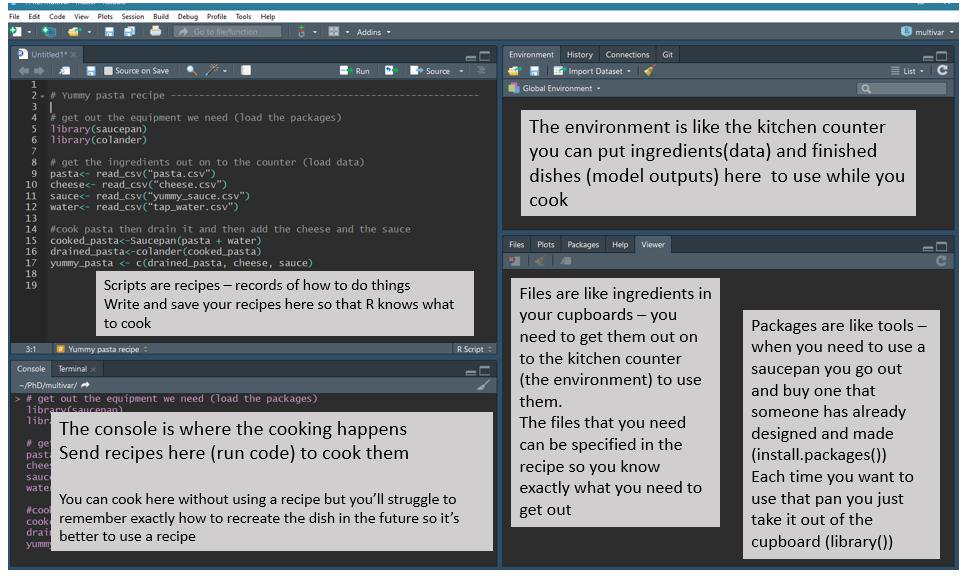
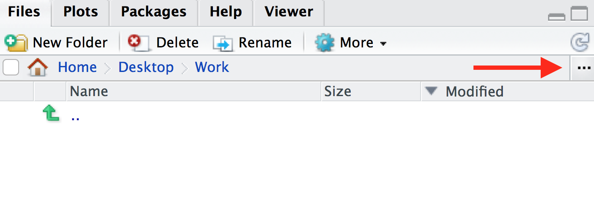
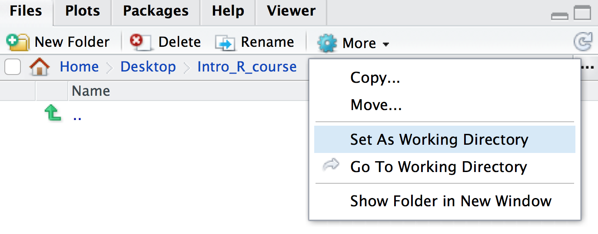

# Intro to R and RStudio

RStudio is an interface that makes it easier to use R. There are four windows in RStudio. The screenshot below shows an [analogy linking the different RStudio windows to cooking](https://twitter.com/RLadiesNCL/status/1138812826917724160).



\  
\  
\  

## R script vs console

There are two ways to work in RStudio in the console or in a script. We can type a command in the console and press `Enter` to run it. Try running the command below in the console.

```{r}
1 + 1
```

Or we can use an R script. To create a script, from the top menu in RStudio: `File > New File > R Script`. Now type the command below in the script. This time, to run the command, you use `Ctrl` + `Enter` for Windows/Linux or `Cmd` + `Enter` for MacOS. This sends the command where the cursor is from the script to the console. You can highlight multiple commands and then press `Cmd/Ctrl` + `Enter` to run them one after the other.

```{r}
2 + 2
```

As the RStudio screenshot above explains, if we work in the console we don't have a good record (recipe) of what we've done. We can see commands we've run in the History panel (top right window), and we can go backwards and forwards through our history in the console using the up arrow and down arrow. But the history includes everything we've tried to run, including our mistakes so it is good practice to use an R script.

We can also add comments to a script. These are notes to ourself or others about the commands in the script. Comments start with a `#` which tells R not to run them as commands.

```{r}
# testing R
2 + 2
```

Keeping an accurate record of how you've manipulated your data is important for [reproducible research](https://ropensci.github.io/reproducibility-guide/sections/introduction/). Writing detailed comments and documenting your work are useful reminders to your future self (and anyone else reading your scripts) on what your code does.

## Working directory

Opening an RStudio session launches it from a specific location. This is the ‘working directory’. **R looks in the working directory by default to read in data and save files.** You can find out what the working directory is by using the command `getwd()`. This shows you the path to your working directory in the console. In Mac this is in the format `/path/to/working/directory` and in Windows `C:\path\to\working\directory`. It is often useful to have your data and R scripts in the same directory and set this as your working directory. We will do this now.

Make a folder for this course somewhere on your computer that you will be able to easily find. Name the folder for example, `Intro_R_course`. Then, to set this folder as your working directory:

In RStudio click on the ‘Files’ tab and then click on the three dots, as shown below.



In the window that appears, find the folder you created (e.g. `Intro_R_course`), click on it, then click ‘Open’. The files tab will now show the contents of your new folder. Click on `More > Set As Working Directory`, as shown below.



Save the script you created in the previous section as `intro.R` in this directory. You can do this by clicking on `File > Save` and the default location should be the current working directory (e.g. `Intro_R_course`).

_Note: You can use an RStudio project as described [here](https://r4ds.had.co.nz/workflow-projects.html) to automatically keep track of and set the working directory._

## Packages

If it's not already installed on your computer, you can use the `install.packages` **function** to install a **package**. A package is a collection of functions along with documentation, code, tests and example data.

```{r, eval=FALSE}
install.packages("tidyverse")
```

We will see many functions in this tutorial. Functions are "canned scripts" that automate more complicated sets of commands. Many functions are predefined, or can be made available by importing R packages. A function usually takes one or more inputs called *arguments*. Here tidyverse is the argument to the `install.packages()` function. 

_Note: functions require parentheses after the function name._

## Getting help

To see what any function in R does, type a `?` before the name and help information will appear in the Help panel on the right in RStudio. Or you can search the function name in the Help panel search box. Google and [Stack Overflow](https://stackoverflow.com/) are also useful resources for getting help.

```{r, eval=FALSE}
?install.packages
```

> ### Tab completion
> A very useful feature is Tab completion. You can start typing and use <kbd>Tab</kbd> to autocomplete code, for example, a function name.

## Common R errors

R error messages are common and can sometimes be cryptic. You most likely will encounter at least one error message during this tutorial. Some common reasons for errors are:

- Case sensitivity. In R, as in other programming languages, case sensitivity is important. ?install.packages is different to ?Install.packages.
- Missing commas
- Mismatched parentheses or brackets
- Not quoting file paths
- Not finishing a command so seeing "+" in the console. If you need to, you can press ESC to cancel the command.

To see examples of some R error messages with explanations see [here]( https://github.com/noamross/zero-dependency-problems/issues/7)


