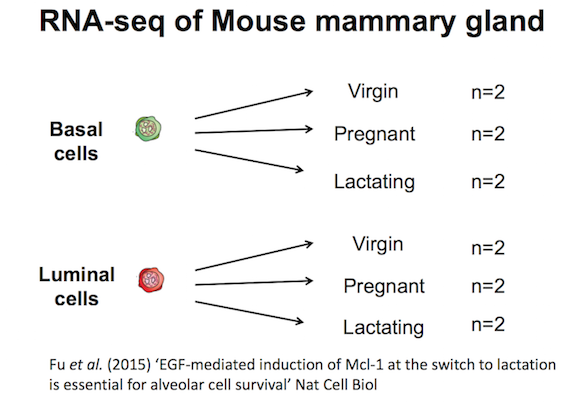
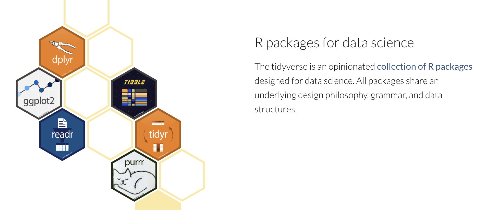

# Getting started with data


## Data files
The data files required for this workshop are available on [GitHub](https://github.com/melbournebioinformatics/r-intro-biologists/blob/master/data.zip). To download the data.zip file, you can click [here](https://github.com/melbournebioinformatics/r-intro-biologists/raw/master/data.zip). Unzip the file and store this `data` folder in your working directory.


## GREIN (GEO RNA-seq Experiments Interactive Navigator)
In this tutorial, we will learn some R through creating plots to visualise data from an RNA-seq experiment. RNA-seq counts file can be obtained from the [GREIN platform](https://www.nature.com/articles/s41598-019-43935-8). GREIN provides >6,500 published datasets from GEO that have been uniformly processed. It is available at http://www.ilincs.org/apps/grein/. You can search for a dataset of interest using the GEO code. We obtained the dataset used here using the code GSE60450. GREIN provide QC metrics for the RNA-seq datasets and both raw and normalized counts. We will use the normalized counts here. These are the counts of reads for each gene for each sample normalized for differences in sequencing depth and composition bias. Generally, the higher the number of counts the more the gene is expressed.
\  
\ 

## RNA-seq dataset
Here we will create some plots using RNA-seq data from the paper by [Fu et al. 2015](https://www.ncbi.nlm.nih.gov/pubmed/25730472), GEO code GSE60450. This study examined expression in basal and luminal cells from mice at different stages (virgin, pregnant and lactating). There are 2 samples per group and 6 groups, 12 samples in total.



## Tidyverse

{width=100% }


In this course we will use the **tidyverse**. The tidyverse is a collection of R packages that includes the extremely widely used **`ggplot2`** package.

\  
\  
\  

{width=100% }

\  
\  
\ 

The [tidyverse](https://www.tidyverse.org/) makes data science faster, easier and more fun.

\  
\  
\  

[Why tidyverse? Why tidy data? Why is it such a game-changer?](https://www.openscapes.org/blog/2020/10/12/tidy-data/)

## Loading the data

We use `library()` to load in the packages that we need. As described in the cooking analogy in the first screenshot, `install.packages()` is like buying a saucepan, `library()` is taking it out of the cupboard to use it.

```{r, message=FALSE, warning=FALSE}
library(tidyverse)
```

The files we will use are csv comma-separated, so we will use the `read_csv()` function from the tidyverse. There is also a `read_tsv()` function for tab-separated values.

We will use the counts file called `GSE60450_GeneLevel_Normalized(CPM.and.TMM)_data.csv` that's in a folder called `data` i.e. the path to the file should be `data/GSE60450_GeneLevel_Normalized(CPM.and.TMM)_data.csv`.

We can read the counts file into R with the command below. We'll store the contents of the counts file in an **object** called `counts`. This stores the file contents in R's memory making it easier to use.

```{r}
# read in counts file
counts <- read_csv("data/GSE60450_GeneLevel_Normalized(CPM.and.TMM)_data.csv")

# read in metadata
sampleinfo <- read_csv("data/GSE60450_filtered_metadata.csv")
```

There is some information output by read_csv on "column specification". It tells us that there is a missing column name in the header and it has been filled with the name "...1", which is how read_csv handles missing column names by default. It also tells us what data types read_csv is detecting in each column. Columns with text characters have been detected (col_character) and also columns with numbers (col_double). We won't get into the details of R data types in this tutorial but they are important to know and you can read more about them in the [R for Data Science book](https://r4ds.had.co.nz/vectors.html#important-types-of-atomic-vector).

In R we use `<-` to assign values to objects. `<-` is the **assignment operator**.  It assigns values on the right to objects on the left. So to create an object, we need to give it a name (e.g. `counts`), followed by the assignment operator `<-`, and the value we want to give it. We can give an object almost any name we want but there are some rules and conventions as described in the [tidyverse R style guide](https://style.tidyverse.org/syntax.html#object-names)

We can read in a file from a path on our computer on on the web and use this as the value. Note that we need to put quotes ("") around file paths.


<p>
<div class="info">
**ⓘ Assignment operator shortcut**  
In RStudio, typing <kbd>Alt</kbd> + <kbd>-</kbd> (holding down <kbd>Alt</kbd> at the
same time as the <kbd>-</kbd> key) will write ` <- ` in a single keystroke in Windows, 
while typing > <kbd>Option</kbd> + <kbd>-</kbd> (holding down <kbd>Option</kbd> at the
same time as the <kbd>-</kbd> key) does the same in a Mac. 
</div>
</p>


#### Exercise

1. Test what happens if you type 
`Library(tidyverse)`  
What is wrong and how would you fix it?

2. Test what happens if you type 
`libary(tidyverse)`  
What is wrong and how would you fix it?

3. Test what happens if you type
`library(tidyverse`  
What is wrong and how would you fix it?

4. Test what happens if you type  
`read_tsv("data/GSE60450_filtered_metadata.csv")`  
What is wrong and how would you fix it?  
 
5. Test what happens if you type  
`read_csv("data/GSE60450_filtered_metadata.csv)`  
What is wrong and how would you fix it?  
 
6. Test what happens if you type  
`read_csv("GSE60450_filtered_metadata.csv)`  
What is wrong and how would you fix it?  
 
7. What is the name of the first column you get with each of these 2 commands?  
`read.csv("data/GSE60450_filtered_metadata.csv")`  
and  
`read_csv("data/GSE60450_filtered_metadata.csv")`  
 
8. If you run  
`read_csv("data/GSE60450_filtered_metadata.csv")`  
what is the difference between the column header you see `developmental stage` and 'developmental stage'?  


