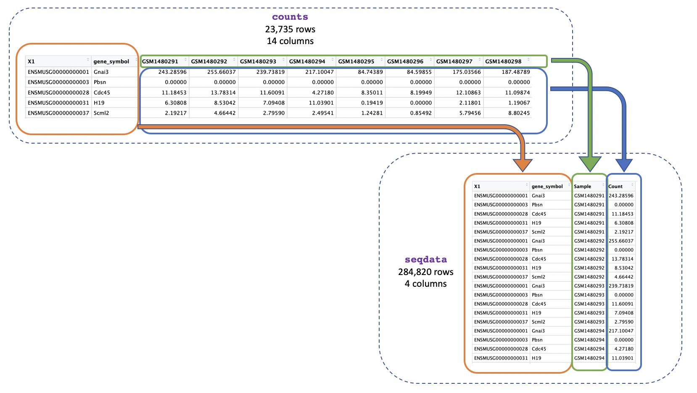
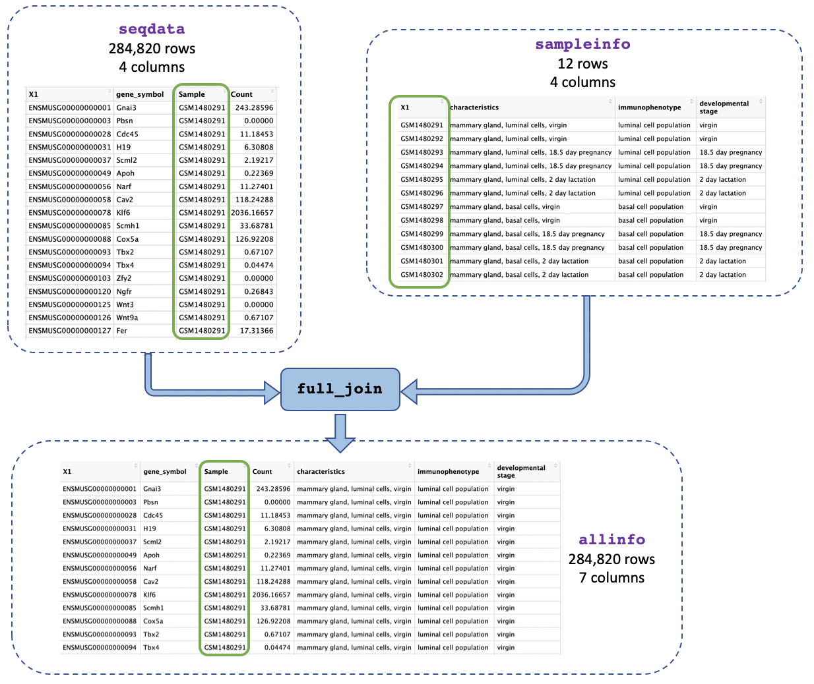

```{r shared-setup, include=FALSE}
source("R/setup.R")
```

# Formatting the data

## Converting from wide to long format

We will first convert the data from wide format into long format to make it easier to work with and plot with ggplot. We want just one column containing all the expression values instead of multiple columns with counts for each sample, as shown in the image below.



We can use `pivot_longer()` to easily change the format into long format.

```{r}
seqdata <- pivot_longer(counts, cols = starts_with("GSM"), names_to = "Sample", 
                        values_to = "Count")
```

We use `cols = starts_with("GSM")` to tell the function we want to reformat the columns whose names start with "GSM". `pivot_longer()` will then reformat the specified columns into two new columns, which we're naming "Sample" and "Count". The `names_to = "Sample"` specifies that we want the new column containing the columns we sepcified with `cols` to be named "Sample", and the `values_to = "Count"` specifies that we want the new column contining the values to be named "Count".

We could also specify a column range to reformat. The command below would give us the same result as the previous command.

```{r}
seqdata <- pivot_longer(counts, cols = GSM1480291:GSM1480302, 
                        names_to = "Sample", values_to = "Count")
```

Alternatively, we could specify the columns we *don't* want to reformat and `pivot_longer()` will reformat all the other columns. To do that we put a minus sign "-" in front of the column names that we don't want to reformat. This is a pretty common way to use `pivot_longer()` as sometimes it is easier to exclude columns we don't want than include columns we do. The command below would give us the same result as the previous command.

```{r}
seqdata <- pivot_longer(counts, cols = -c("gene_id", "gene_symbol"), 
                        names_to = "Sample", values_to = "Count")
```

Here we see the function `c()` for the first time. We use this function extremely often in R when we have multiple items that we are *combining*. We will see it again in this tutorial.

Let's have a look at the data.

```{r}
seqdata
```

## Joining two tables

Now that we've got just one column containing sample ids in both our counts and metadata objects we can join them together using the sample ids. This will make it easier to identify the categories for each sample (e.g. if it's basal cell type) and to use that information in our plots.



We will use the function `full_join()` and give it the two tables we want to join. We add `by = join_by(Sample == sample_id)` to say we want to join on the column called "Sample" in the first table (`seqdata`) and the column called "sample_id" in the second table (`sampleinfo`) when the values match.

```{r}
allinfo <- full_join(seqdata, sampleinfo, by = join_by(Sample == sample_id))
```

Let's have a look at the data.
```{r}
allinfo
```

The two tables have been joined.

#### Exercise

1. View the help page of the `head` function and find the "Arguments" heading. What does the `n` argument do? How many rows and columns do you get with `head(sampleinfo, n = 8)`?  
2. Store the output of the first 20 lines of the `counts` object in a new variable named `subset_counts`. What is the gene_symbol in row 20?  
3. View the values in the `GSM1480291` column from your `subset_counts` object using the `$` subsetting method. What is the 5th value?  
4. View the help page of the `mean` function. What is the mean of the column of values you obtained from the previous question?  
5. How can you use `pivot_longer` to transform `dat` into a ‘tidy’ data called `dat_long` that contains 3 columns (sample, experiment, count).
```
dat <-  tibble(sample = 1:10,
               experiment_1 = rnorm(10),
               experiment_2 = rnorm(10))
```             
`dat_long` should look similar to what you get if you paste this into the console (the values in the count column will be different):
```
dat_long <- tibble(sample = rep(1:10, each=2),
                   experiment = rep(c("experiment_1", "experiment_2"), 10),
                   count = rnorm(20))
dat_long
```
6. Say you have another table containing sample information with samples assigned to either "Mutant" or "Control" such as:
```
sample_info <- tibble(sample = 1:100,
                      group = c(rep("Mutant", 50), rep("Control", 50)))
```
Join `dat_long` to `sample_info` using the common column called "sample". How many rows do you get if you use i) `full_join`, ii) `left_join`, iii)  `right_join`, iv) `inner_join`?


