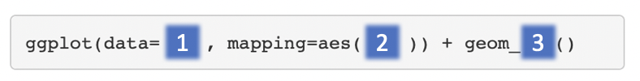

```{r shared-setup, include=FALSE}
source("R/setup.R")
```

# Plotting with **`ggplot2`**

**`ggplot2`** is a plotting package that makes it simple to create complex plots. One really great benefit of ggplot2 versus the older base R plotting is that we only need to make minimal changes if the underlying data change or if we decide to change our plot type, for example, from a box plot to a violin plot. This helps in creating publication quality plots with minimal amounts of adjustments and tweaking.

**`ggplot2`** likes data in the 'long' format, i.e., a column for every variable, and a row for every observation, similar to what we created with `pivot_longer()`. Well-structured data will save you lots of time when making figures with **`ggplot2`**.

As we shall see, ggplot graphics are built step by step by adding new elements using the `+`. Adding layers in this fashion allows for extensive flexibility and customization of plots.

To build a ggplot, we use the following basic template that can be used for different types of plots. Three things are required for a ggplot:



1. The data
2. The columns in the data we want to map to visual properties (called aesthetics or aes in ggplot2) e.g. the columns for x values, y values and colours
3. The type of plot (the geom_)

There are different geoms we can use to create different types of plot e.g. `geom_line()` `geom_point()`, `geom_boxplot()`. To see the geoms available take a look at the ggplot2 help or the handy [ggplot2 cheatsheet](https://github.com/rstudio/cheatsheets/raw/master/data-visualization-2.1.pdf). Or if you type "geom" in RStudio, RStudio will show you the different types of geoms you can use.

## Creating a boxplot

We can make boxplots to visualise the distribution of the counts for each sample. This helps us to compare the samples and check if any look unusual. 

_Note: with ggplot the "+" must go at the end of the line, it can't go at the beginning._

```{r}
ggplot(data = allinfo, mapping = aes(x = Sample, y = Count)) + 
  geom_boxplot()
```

We have generated our first plot!

But it looks a bit weird. It's because we have some genes with extremely high counts. To make it easier to visualise the distributions we usually plot the logarithm of RNA-seq counts. We'll plot the Sample on the X axis and log~ 2~  Counts on the y axis. We can log the Counts within the `aes()`. The sample labels are also overlapping each other, we will show how to fix this later.

```{r}
ggplot(data = allinfo, mapping = aes(x = Sample, y = log2(Count))) + 
  geom_boxplot()
```

We get a warning here about rows containing non-finite values being removed. This is because some of the genes have a count of zero in the samples and a log of zero is undefined. We can add a small number to every count to avoid the zeros being dropped.

```{r}
ggplot(data = allinfo, mapping = aes(x = Sample, y = log2(Count + 1))) + 
  geom_boxplot()
```

The box plots show that the distributions of the samples are not identical but they are not very different.

Box plots are useful summaries, but hide the shape of the distribution. For example, if the distribution is bimodal, we would not see it in a boxplot. An alternative to the boxplot is the **violin plot**, where the shape (of the density of points) is drawn. See [here](https://blog.bioturing.com/2018/05/16/5-reasons-you-should-use-a-violin-graph/) for an example of how differences in distribution may be hidden in box plots but revealed with violin plots.

#### Exercise
You can easily make different types of plots with ggplot by using different geoms. Using the same data (same x and y values), try editing the code above to make a violin plot (Hint: there's a `geom_violin`)


